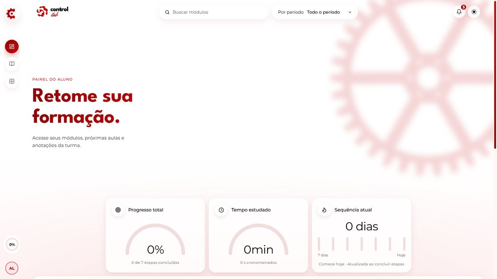
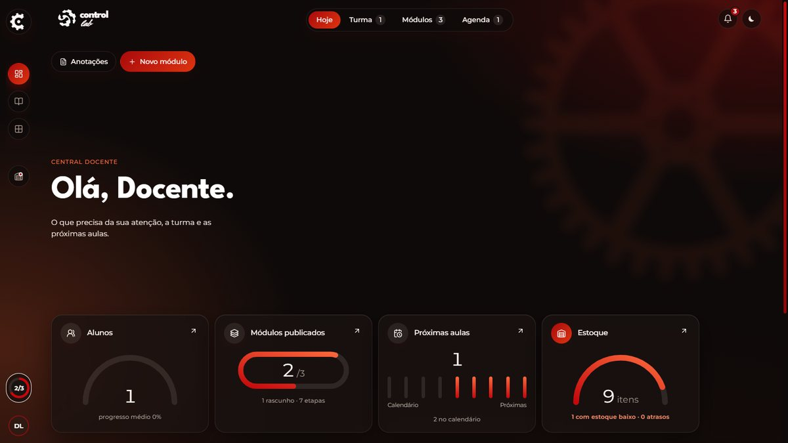

# Control Lab — Ferramentaria

Plataforma web para o ensino de ferramentaria. Reúne dois contextos em um único sistema:

- **Área educacional**: biblioteca e editor de módulos; leitor de etapas com quizzes, progresso e cronômetro registrados no servidor; recursos técnicos com anexos e vínculo ao estoque; agenda escolar, diário de aula e notificações; competências (badges), painéis de acompanhamento e perfil do aluno.
- **Gestão escolar**: administração de contas, papéis e turmas; docentes acompanham alunos das próprias turmas, enquanto a administração gerencia os acessos e supervisiona o estoque.
- **Estoque da ferramentaria** (docentes operam; administração supervisiona): ferramentas, máquinas, materiais e peças com saldo físico/reservado/disponível, localização, conservação, entradas e saídas, ajustes justificados, empréstimos com reserva → retirada → devolução, alertas, auditoria e vínculo com os recursos dos módulos.

Projeto resultante da unificação do **ForgeLab** (base técnica) com as regras de negócio do protótipo **ControlLab**. O porquê de cada decisão está em [`docs/AUDITORIA_INTEGRACAO_DOIS_PROJETOS.md`](docs/AUDITORIA_INTEGRACAO_DOIS_PROJETOS.md).

## Linha do tempo do design

[Assista ao vídeo](docs/design/linha-do-tempo-design.mp4) (58 segundos, sem áudio) com as cinco versões do design, de 23/10 a 05/11/2026. O resumo de cada versão está em [`docs/design/HISTORICO_DO_DESIGN.md`](docs/design/HISTORICO_DO_DESIGN.md).





---

## Aluno × docente

| | Aluno (`student`) | Docente (`teacher`) | Administração (`admin`) |
|---|---|---|---|
| Biblioteca e leitor (módulos publicados) | ✅ | ✅ (inclui rascunhos) | ✅ |
| Quizzes, progresso e cronômetro próprios | ✅ | — (pré-visualiza sem alterar) | — |
| Diário pessoal e competências próprias | ✅ | — | — |
| Editor de módulos | — | ✅ | ✅ |
| Agenda de aulas | — | ✅ (gerencia) | ✅ (visualiza) |
| Acompanhar alunos e atribuir competências | — | ✅ (próprias turmas) | ✅ (todos) |
| Operar estoque (cadastro, movimentações e empréstimos) | ❌ | ✅ | ✅ |
| Gerir contas e turmas | ❌ | ❌ | ✅ |
| Supervisionar estoque | ❌ | ❌ | ✅ |

O papel vem **sempre** da sessão validada no servidor. Detalhes em [`docs/PERMISSOES_E_ACESSOS.md`](docs/PERMISSOES_E_ACESSOS.md).

## Recursos essenciais

- **Acesso e segurança**: login por e-mail e senha, sessão persistente e revogável, contas ativáveis/desativáveis e permissões verificadas no servidor. A administração cria contas, define papéis e associa alunos a turmas.
- **Ensino e aprendizagem**: módulos publicados organizados em etapas sequenciais; quizzes por etapa; progresso e tempo registrados no servidor; biblioteca e leitor para estudo, além de editor e pré-visualização docente.
- **Acompanhamento escolar**: agenda de aulas, diário de anotações do aluno, consulta docente aos diários dos alunos de suas turmas, acompanhamento de progresso/tempo e atribuição de competências. A administração cadastra turmas e supervisiona operações de estoque.
- **Conteúdo técnico**: recursos por módulo, imagens e anexos; docentes podem associar recursos a itens do estoque. Dados de disponibilidade são exibidos somente a docentes e à administração.
- **Estoque**: cadastro e arquivamento de itens/categorias, controle de saldo e reservas, movimentações auditáveis, empréstimos e devoluções, alertas e supervisão administrativa por turma e docente.
- **Perfil e interface**: foto de perfil, notificações, tema claro/escuro e interface responsiva.

As regras de acesso e o escopo dos dados por papel estão detalhados em [`docs/PERMISSOES_E_ACESSOS.md`](docs/PERMISSOES_E_ACESSOS.md); os percursos funcionais estão em [`docs/FLUXOS_DO_SISTEMA.md`](docs/FLUXOS_DO_SISTEMA.md).

## Como o estoque funciona

- **Disponível = físico − reservado.** Nenhuma operação deixa saldo negativo nem reserva maior que o físico (regra no código e `CHECK` no banco).
- **Entrada / saída / ajuste**: cada movimentação grava responsável, data, motivo, referência e o saldo antes e depois. Ajustes, perdas e avarias exigem justificativa.
- **Empréstimo** (itens devolvíveis): criar reserva → confirmar retirada (desconta o físico uma única vez) → registrar devolução (parcial ou total). Unidades devolvidas com avaria ficam registradas e **não** voltam ao disponível.
- **Arquivar** em vez de excluir: o item sai das listas, mas o histórico e os módulos que o citam continuam mostrando a referência original.
- **Integração com os módulos**: no editor, cada recurso técnico pode apontar para um item do estoque. O docente vê a disponibilidade no leitor; o aluno não recebe nenhum dado do estoque.

Fluxos completos em [`docs/FLUXOS_DO_SISTEMA.md`](docs/FLUXOS_DO_SISTEMA.md).

---

## Pré-requisitos

- **Node.js 22.16 ou mais novo** (Node 22 LTS atualizado ou 24) e **pnpm** (`corepack enable` ativa o pnpm que vem com o Node).
- **Banco**: um projeto no **Supabase** (Postgres), gratuito. Nada a instalar no computador. Veja [Banco no Supabase](#banco-no-supabase).
- **VS Code** com as extensões sugeridas em `.vscode/extensions.json` (opcional).

## Primeira execução (VS Code)

No Windows, deixe o projeto em um caminho curto (por exemplo `C:\ControlLab`): em pastas muito fundas, o `node_modules` ultrapassa o limite de caminho do sistema e o build falha.

Abra a pasta do projeto no VS Code e, no terminal integrado:

```bash
pnpm install                 # 1. dependências
cp .env.example .env         # 2. configuração (no Windows: copy .env.example .env); preencha DATABASE_URL
pnpm db:setup                # 3. cria as tabelas no Supabase e a seed de demonstração
pnpm dev                     # 4. inicia frontend + API em http://localhost:3000
```

As mesmas etapas existem como tarefas: **Terminal → Executar Tarefa → “Control Lab: …”**.

### Configurar o `.env`

O arquivo `.env.example` documenta todas as variáveis. As principais:

| Variável | Para que serve |
|---|---|
| `DATABASE_URL`, `DATABASE_SSL` | Conexão com o Postgres do Supabase (veja [Banco no Supabase](#banco-no-supabase)). |
| `DATABASE_PROVIDER` | `postgres` (padrão). `sqlite` usa um arquivo local (`DATABASE_FILE`), como fazem os testes automáticos. |
| `STORAGE_DRIVER` | Onde ficam fotos e anexos: `database` (padrão com Postgres, tabela `stored_files`) ou `disk` (`UPLOAD_DIR`). |
| `SESSION_SECRET` | Assina as sessões. Troque por um valor longo e aleatório (≥ 32 caracteres em produção). |
| `SESSION_TTL_HOURS` | Validade da sessão (padrão 12 h). |
| `APP_URL`, `PORT`, `NODE_ENV` | Endereço, porta e ambiente. |
| `SEED_*` | Contas de **desenvolvimento** criadas pela seed. |

Se o banco não puder ser aberto ou ainda não tiver tabelas, o servidor mostra no terminal o motivo e o que fazer (`DATABASE_URL`, senha, `pnpm db:setup`).

### Contas de desenvolvimento

A seed cria contas **apenas para desenvolvimento**: docente e aluno são obrigatórios; a conta de administração só é criada quando `SEED_ADMIN_PASSWORD` está definido. E-mails e senhas vêm do seu `.env` (`SEED_TEACHER_*`, `SEED_STUDENT_*` e `SEED_ADMIN_*`). Com o `.env.example` sem alterações:

- Docente: valor de `SEED_TEACHER_EMAIL` / `SEED_TEACHER_PASSWORD`
- Aluno: valor de `SEED_STUDENT_EMAIL` / `SEED_STUDENT_PASSWORD`
- Administração: valor de `SEED_ADMIN_EMAIL` / `SEED_ADMIN_PASSWORD`

A interface nunca exibe senhas; em desenvolvimento ela mostra o selo **DEV** e indica onde encontrar as contas. Para contas reais:

```bash
pnpm user:create -- --email maria@escola.br --name "Maria Silva" --role teacher
```

(a senha é pedida no terminal).

## Banco de dados

| Comando | O que faz |
|---|---|
| `pnpm db:setup` | Aplica as migrations e roda a seed. Seguro para repetir. |
| `pnpm db:migrate` | Aplica somente as migrations pendentes. |
| `pnpm db:seed` | Roda a seed idempotente (não duplica dados). |
| `pnpm db:export-sql` | Gera `supabase/controllab-supabase.sql` (estrutura + seed) para colar no SQL Editor do Supabase. |
| `pnpm db:generate` | Gera uma nova migration a partir de `drizzle/schema.ts`. |
| `pnpm db:reset` | **Apaga** e recria o banco de desenvolvimento (pede confirmação; bloqueado em produção). Pare o `pnpm dev` antes. |

Estrutura completa em [`docs/BANCO_DE_DADOS.md`](docs/BANCO_DE_DADOS.md).

## Banco no Supabase

O banco do sistema é o Postgres do **Supabase**. Há duas formas de prepará-lo:

**A. Pelo navegador (sem rodar nada no computador)**

1. No Supabase, abra **SQL Editor → New query**, cole o conteúdo de [`supabase/controllab-supabase.sql`](supabase/controllab-supabase.sql) e clique em **Run**.
2. O script cria todas as tabelas (com RLS ligado) e a seed de demonstração. Pode ser rodado de novo sem duplicar nada.
3. As senhas das contas da seed são sorteadas a cada `pnpm db:export-sql` e ficam em `supabase/CONTAS-SEED.local.txt`, que não vai para o git.

**B. Pelo projeto**

1. Copie a connection string em **Connect → Session pooler** e preencha o `.env`:
   ```env
   DATABASE_PROVIDER=postgres
   DATABASE_URL=postgresql://postgres.<ref>:<senha>@aws-0-<região>.pooler.supabase.com:5432/postgres
   ```
   Caracteres especiais da senha precisam de URL-encode (`&` vira `%26`, `@` vira `%40`).
2. `pnpm db:setup` cria as tabelas e a seed (com as senhas `SEED_*` do `.env`).

Redes que bloqueiam a porta do Postgres (comum em escolas) impedem o passo B e o `pnpm dev` com Supabase; o passo A e o sistema publicado na Vercel não são afetados. Sem internet, `DATABASE_PROVIDER=sqlite` usa um arquivo local (`data/forgelab.db`).

## Deploy na Vercel

O projeto já vem configurado (`vercel.json`): o frontend sai da CDN da Vercel e a API roda como uma função Node em São Paulo (`gru1`), perto do Supabase.

1. **Banco**: prepare o Supabase (passo A acima).
2. **Projeto**: na Vercel, **Add New → Project** e importe o repositório. Não mude nada nas configurações de build: o `vercel.json` define `pnpm build:vercel`.
3. **Variáveis de ambiente** (Settings → Environment Variables):

   | Variável | Valor |
   |---|---|
   | `DATABASE_URL` | Connection string do Supabase em **Connect → Transaction pooler** (porta 6543), com a senha em URL-encode. |
   | `SESSION_SECRET` | Valor novo e aleatório, ≥ 32 caracteres: `node -e "console.log(require('crypto').randomBytes(48).toString('base64url'))"` |
   | `APP_URL` | Endereço do site na Vercel (ex.: `https://controllab.vercel.app`). |
   | `TRUST_PROXY` | `1` (o limite de tentativas de login passa a ver o IP real). |

   `NODE_ENV`, `DATABASE_PROVIDER` e `STORAGE_DRIVER` não precisam ser definidos: a função já roda em produção, com Postgres e com os arquivos no banco.
4. **Deploy**. A função recusa iniciar com configuração incompleta e diz o que falta no log da Vercel.
5. **Contas reais**: crie pela tela de administração, ou com `pnpm user:create` apontando o `.env` para o Supabase.

Limites da Vercel: cada envio de arquivo vai até **4,5 MB** (fotos, imagens de módulos e anexos maiores que isso são recusados pela Vercel) e cada requisição tem até 30 s.

Outra hospedagem Node (Render, Railway…): build `pnpm install --prod=false && pnpm build`, antes de iniciar `pnpm db:migrate`, start `pnpm start`, com as mesmas variáveis e `NODE_ENV=production`.

## Testes, verificação e build

```bash
pnpm check     # TypeScript
pnpm test      # Vitest (regras de estoque, permissões, sessão, progresso, cronômetro…)
pnpm build     # frontend (Vite) + servidor (esbuild) em dist/
pnpm start     # executa o build de produção (o bundle do servidor já roda em modo production)
pnpm test:e2e  # Playwright: fluxos reais no navegador, acessibilidade (axe) e celular
```

Os testes de navegador sobem um servidor próprio na porta 3920, com banco e uploads em `e2e/.tmp`, recriados a cada execução: o banco de `data/` não é tocado e o `pnpm dev` pode continuar aberto. Localmente usam o Google Chrome instalado; sem ele, rode `pnpm exec playwright install chromium` e defina `CI=1`. Cobrem login e permissões, o aluno concluindo uma etapa (com a espera mínima de 20 s), o docente criando módulo e fazendo um empréstimo completo, falhas do servidor, uma turma de 30 alunos com 200 itens no estoque, a auditoria WCAG 2.1 AA nos dois temas e a ausência de rolagem lateral em 390 px. Uma execução leva cerca de 4 minutos.

## Resetar o ambiente local

```bash
pnpm db:reset            # recria banco + seed (pergunta antes)
pnpm uploads:clean       # lista imagens/anexos que nenhum registro usa mais
pnpm uploads:clean -- --yes  # apaga esses arquivos
```

Ou, para começar do zero sem a seed, apague a pasta `data/` e rode `pnpm db:setup -- --no-seed`.

No navegador, “Sair” encerra e revoga a sessão no servidor.

## Estrutura

```
client/        React 19 + Vite + Tailwind 4 + Framer Motion (telas, login, estoque; estilos em src/styles/)
server/        Express + tRPC (autenticação, módulos, progresso, estoque)
shared/        regras e validações usadas pelo cliente e pelo servidor
drizzle/       schema (Drizzle) e migrations; postgres/ = estrutura do Supabase
supabase/      script único para o SQL Editor do Supabase (estrutura + seed)
scripts/       setup, migração, seed, reset e criação de usuários
e2e/           testes de navegador (Playwright + axe)
patches/       correção aplicada ao wouter na instalação (pnpm)
docs/          auditoria, permissões, banco e fluxos (+ histórico do design)
```

## Documentação

- [Auditoria e decisões da integração](docs/AUDITORIA_INTEGRACAO_DOIS_PROJETOS.md)
- [Permissões e acessos](docs/PERMISSOES_E_ACESSOS.md)
- [Banco de dados](docs/BANCO_DE_DADOS.md)
- [Fluxos do sistema](docs/FLUXOS_DO_SISTEMA.md)
- [Histórico do design, com vídeo da linha do tempo](docs/design/HISTORICO_DO_DESIGN.md)

> Nunca coloque senhas reais no repositório ou neste README. O `.env` está no `.gitignore`.
